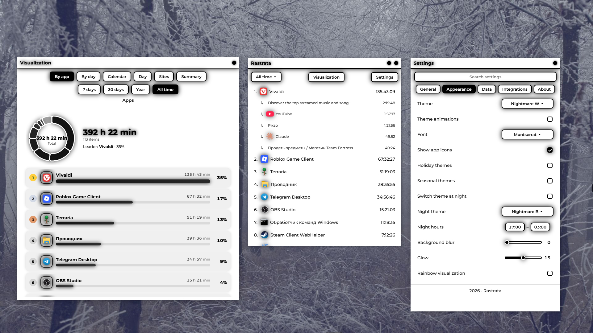

<div align="center">

**English** · [Русский](./README.ru.md)


# Rastrata

**A time tracker for the apps you use on Windows**

Rastrata is a lightweight desktop app that tracks how much time you spend in each program and shows your statistics for any period: from today to your entire usage history.

</div>

---

## Features

- **Real-time tracking:** the active app is detected instantly, with no polling and no extra system load
- **App exclusion:** choose programs that should not be tracked
- **Website tracking:** with their icons
- **Stats by period:** today, yesterday, 7 days, 30 days, year, all time
- **Data visualization:** interactive charts by app and by day with drill-down (click an app to see its usage per day, click a day to see the apps used that day)
- **Statistics:** top apps, time in apps compared with the 24 hours of a day, and all of it follows the selected theme
- **Calendar:** the last 12 months with the activity of every day
- **Summaries:** for a month, a season and a year, with the ability to browse past summaries
- **36 themes:** from the classic black-and-white to Windows XP, Evangelion, Glitchcore, Terraria, Minecraft, and soft dark palettes
  - 4 seasonal themes: Spring, Summer, Autumn, Winter
  - 4 holiday themes: Halloween, New Year, Thanksgiving, Longest Night Day
- **Animation for every theme**
- **Themes split into dark and light**
- **Automatic theme switching:** during holidays, during seasons, and during the night session
- **Glow**
- **Night session hours:** choose when the night session starts and ends
- **Background blur**
- **Resizable settings window:** it now has the same default size as the main window
- **Custom window size**
- **Settings search**
- **Custom fonts:** choose any font installed on your system
- **93 languages:** the interface adapts to your system language automatically and can be switched in settings
- **Data export:** your entire history is copied to a folder on your desktop as plain JSON files (`stats.json`, `names.json`, `icons.json`), see [below](#data-export-and-storage) for details
- **App icons:** the list shows the real icons of your processes
- **Launch on startup:** starts minimized to the tray, with no extra windows when Windows boots
- **Desktop shortcut:** created in one click from settings
- **Auto-update:** the app checks GitHub for new versions and updates itself
- **Privacy:** all statistics are stored locally, nothing is sent to any server
- **Discord integration:** a profile status with your own lines and variables, see [below](#discord-integration) for details
- **Minimal system load:** with no delays


## Screenshot



## Installation

1. Go to [Releases](https://github.com/boochear/rastrata/releases)
2. Download `Rastrata-X.X.X-win-x64-full.zip`
3. Extract the archive to any folder
4. Run `Rastrata.exe`

The app works on **Windows 10/11** and needs no installation: just extract and run.

## How it works

Rastrata tracks active window changes through Windows system events and records time per process. The bare desktop and system overlays (Start menu, search) do not count as activity.

All data is stored locally as JSON files next to the app. There is no telemetry and no data is sent anywhere.

The day changes exactly at 00:00 your local time: if an app was running past midnight, the time is split between the two days.

## Discord integration

Rastrata can show in your Discord profile what you are doing right now. For example:

> **Using Visual Studio Code**
> Today: 5 h 12 min

You can turn it on in **Settings → Integrations → Discord status**.

### How it works

- Rastrata talks to the Discord app running on the same computer through a local channel (Rich Presence). Nothing is sent to Rastrata servers: the status is shown by Discord itself.
- You need the **Discord desktop app** running on this PC (it does not work with the web version). Showing your activity status must be enabled in Discord ("Privacy → Activity status").
- The status updates about every 15 seconds. If Discord was closed and started again, Rastrata reconnects to it on its own.
- The Rastrata icon is always shown in the profile.

### Settings

| Setting | What it does |
|---|---|
| **First line** | Template for the top line of the status. If empty, `Using {app}` is used |
| **Second line** | Template for the bottom line of the status. If empty, `Today: {time}` is used |
| **Show session timer** | Adds a timer to Discord: how long you have been in the current app (for example, "12:34") |

### Variables

You can put variables in curly braces into the lines. Rastrata replaces them with current values:

| Variable | What is inserted | Example |
|---|---|---|
| `{app}` | Name of the active app | Visual Studio Code |
| `{site}` | The site open in the browser (requires "Track websites") | YouTube |
| `{session}` | How long you have been in the current app in a row, since you switched to it | 42 min |
| `{time}` | How much time you have spent in apps today | 5 h 12 min |
| `{percent}` | What share of the 24 hours of the day that is | 21.7% |
| `{top}` | The most used app today | Google Chrome |

Rules:

- Variables can be combined with any text and emoji: `{app} · {session}`.
- If **all** variables in a line are empty (for example, there is no active app or no open site), the line is simply not shown. If only some of them are empty, nothing is inserted in their place.
- Words in curly braces that are not in the table stay as plain text.
- Line length: from 2 to 120 characters. Discord does not accept shorter lines, and Rastrata cuts longer ones.

Examples:

| Line | How it looks |
|---|---|
| `Using {app}` | Using Google Chrome |
| `{app} · {session}` | Google Chrome · 42 min |
| `Site: {site}` | Site: YouTube |
| `Today {time} ({percent})` | Today 5 h 12 min (21.7%) |
| `Top of the day: {top}` | Top of the day: Google Chrome |

## Data export and storage

### Where the data is stored

All files are located next to the app:

| File | What is inside |
|---|---|
| `stats.json` | Time in each app per day |
| `names.json` | Display names of apps |
| `icons.json` | App icons |
| `sites.json` | Time on websites per day |
| `siteicons.json` | Website icons |
| `settings.json` | App settings |

### How to export

Press **Settings → Data → Export data**. Rastrata copies `stats.json`, `names.json` and `icons.json` to the **Rastrata Export** folder on your desktop and opens it. The button shows "Done ✓", or "No data" if there is nothing to export yet.

The files are copied as they are, without changes. You can open them in any text editor, load them into Excel or Google Sheets, or process them with a script. Website data (`sites.json`) is not part of the export; you can copy it from the app folder manually if you need it.

### What the data looks like

**`stats.json`**: the top-level key is a date (`YYYY-MM-DD`), inside it are the process name and the time in milliseconds:

```json
{
  "2026-10-22": {
    "chrome": 5423000,
    "Code": 1830500,
    "Discord": 612000
  },
  "2026-10-21": {
    "chrome": 7200000
  }
}
```

Time is stored in milliseconds: `3 600 000` is 1 hour. In the example above `5423000` is 1 h 30 min 23 s. The process name is the .exe name without the extension.

**`names.json`**: which name to show for each process:

```json
{
  "chrome": "Google Chrome",
  "Code": "Visual Studio Code"
}
```

**`icons.json`**: process icons as PNG encoded in base64:

```json
{
  "chrome": "data:image/png;base64,iVBORw0KGgoAAAANSUhEUg..."
}
```

**`sites.json`** is built the same way as `stats.json`, only with website names instead of processes:

```json
{
  "2026-10-22": {
    "YouTube": 1200000,
    "SoundCloud": 840000
  }
}
```

Example: how many hours in total were spent in Chrome (Python):

```python
import json

stats = json.load(open("stats.json", encoding="utf-8"))
total = sum(day.get("chrome", 0) for day in stats.values())
print(round(total / 3_600_000, 1), "h")
```

## Auto-update

On every launch Rastrata checks the [latest release on GitHub](https://github.com/boochear/rastrata/releases/latest). If a newer version is found, it is downloaded and applied automatically.

## License

This app is distributed **for free**, but with restrictions. See the [LICENSE](./LICENSE) file for details.

In short: you can freely download and use it, but you may not modify it, sell it or pass it off as your own.

## Creator

<div align="center">


**Boochear**

[Telegram](https://t.me/boochear) · b0ochear2208@gmail.com

</div>

---

<div align="center">
<sub>2026 · Rastrata</sub>
</div>