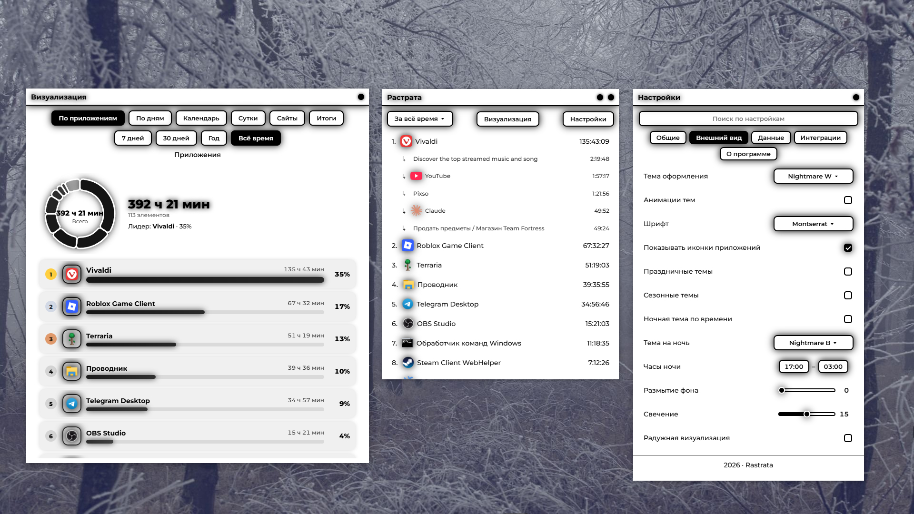

<div align="center">

[English](./README.md) · **Русский**


# Растрата

**Трекер времени, проведённого в приложениях на Windows**

Растрата - это лёгкое desktop-приложение, которое отслеживает, сколько времени ты проводишь в каждой программе, и показывает статистику за любой период: от сегодняшнего дня до всего времени использования.

</div>

---

## Возможности

- **Отслеживание в реальном времени:** активное приложение определяется мгновенно, без опроса и лишней нагрузки на систему
- **Исключение приложений для отслеживания**
- **Отслеживание сайтов:** с отображением их иконок
- **Статистика по периодам:** сегодня, вчера, 7 дней, 30 дней, год, за всё время
- **Визуализация данных:** интерактивные диаграммы по приложениям и по дням с детализацией (клик по приложению показывает его использование по дням, клик по дню показывает приложения за этот день)
- **Статистика:** топ приложений, сравнение времени в приложениях с сутками (24 часа) и всё это так же меняется под выбранную тему
- **Календарь:** 12 последних месяцев с активностью каждого дня
- **Итоги:** за месяц, сезон, год и просмотр прошлых итогов
- **36 тем:** от классической чёрно-белой до Windows XP, Evangelion, Glitchcore, Minecraft и мягких тёмных палитр
  - 4 сезонные темы: Весенняя, Летняя, Осенняя, Зимняя
  - 4 праздничные темы: Хеллоуин, Новый год, День благодарения, День с самой длинной ночью
- **Анимация каждой темы**
- **Разделение тем на тёмные и светлые**
- **Автосмена темы:** во время праздников, сезонов и ночного сеанса
- **Свечение**
- **Время ночного сеанса:** выбери, когда ночной сеанс начинается и заканчивается
- **Блюр фона**
- **Растягиваемое окно настроек:** теперь его размер по умолчанию совпадает с размером главного окна
- **Свой размер окна**
- **Поиск настроек**
- **Свои шрифты:** можно выбрать любой шрифт, установленный в системе
- **93 языка:** интерфейс сам подстраивается под язык системы, переключить его можно в настройках
- **Экспорт данных:** вся история копируется в папку на рабочем столе в виде обычных JSON-файлов (`stats.json`, `names.json`, `icons.json`), подробнее [ниже](#экспорт-и-хранение-данных)
- **Иконки приложений:** список показывает реальные иконки процессов
- **Автозапуск с системой:** со сворачиванием в трей, без лишних окон при старте Windows
- **Ярлык на рабочем столе:** создаётся в один клик из настроек
- **Автообновление:** приложение само проверяет новые версии на GitHub и обновляется
- **Приватность:** вся статистика хранится локально, ничего не отправляется на сервер
- **Интеграция с Discord:** статус в профиле со своими строками и переменными, подробнее [ниже](#интеграция-с-discord)
- **Минимальная нагрузка на систему:** при этом никаких задержек


## Скриншот



## Установка

1. Перейди в [Releases](https://github.com/boochear/rastrata/releases)
2. Скачай `Rastrata-X.X.X-win-x64-full.zip`
3. Распакуй архив в любую папку
4. Запусти `Rastrata.exe`

Приложение работает на **Windows 10/11** и не требует установки: просто распакуй и запускай.

## Как это работает

Растрата отслеживает смену активного окна через системные события Windows и записывает время по каждому процессу. Голый рабочий стол и системные оверлеи (меню Пуск, поиск) не засчитываются как активность.

Все данные хранятся локально в виде JSON-файлов рядом с приложением. Никакой телеметрии, никакой отправки данных куда-либо.

День меняется ровно в 00:00 по твоему времени: если приложение работало через полночь, время делится между двумя днями.

## Интеграция с Discord

Растрата может показывать в твоём профиле Discord, чем ты сейчас занят. Например:

> **Использует Visual Studio Code**
> Сегодня: 5 ч 12 мин

Включается в **Настройки → Интеграции → Статус в Discord**.

### Как это работает

- Растрата общается с запущенным на этом же компьютере Discord через локальный канал (Rich Presence). Ничего не отправляется на серверы Растраты: статус показывает сам Discord.
- Нужен **Discord для компьютера**, запущенный на этом ПК (в веб-версии это не работает). В настройках Discord должен быть включён показ статуса активности («Конфиденциальность → Статус активности»).
- Статус обновляется примерно раз в 15 секунд. Если Discord был закрыт и запущен снова, Растрата подключится к нему сама.
- В профиле всегда показывается значок Растраты.

### Настройки

| Параметр | Что делает |
|---|---|
| **Первая строка** | Шаблон верхней строки статуса. Если пусто, используется `Использует {app}` |
| **Вторая строка** | Шаблон нижней строки статуса. Если пусто, используется `Сегодня: {time}` |
| **Показывать таймер сессии** | Добавляет в Discord таймер: сколько времени ты уже в текущем приложении (например, «12:34») |

### Переменные

В строки можно вставлять переменные в фигурных скобках. Растрата подставит вместо них актуальные значения:

| Переменная | Что подставляется | Пример |
|---|---|---|
| `{app}` | Название активного приложения | Visual Studio Code |
| `{site}` | Сайт, открытый в браузере (нужно включить «Отслеживать сайты») | YouTube |
| `{session}` | Сколько ты находишься в текущем приложении подряд, с момента переключения на него | 42 мин |
| `{time}` | Сколько времени ты провёл в приложениях сегодня | 5 ч 12 мин |
| `{percent}` | Какую долю от 24 часов суток это составляет | 21.7% |
| `{top}` | Самое используемое приложение за сегодня | Google Chrome |

Правила:

- Переменные можно сочетать с любым текстом и эмодзи: `{app} · {session}`.
- Если в строке **все** переменные пустые (например, нет активного приложения или нет открытого сайта), строка просто не показывается. Если пусты только некоторые, на их месте ничего не будет.
- Слова в фигурных скобках, которых нет в таблице, остаются как обычный текст.
- Длина строки: от 2 до 120 символов. Более короткие Discord не принимает, более длинные Растрата обрезает.

Примеры:

| Строка | Как будет выглядеть |
|---|---|
| `Использует {app}` | Использует Google Chrome |
| `{app} · {session}` | Google Chrome · 42 мин |
| `Сайт: {site}` | Сайт: YouTube |
| `Сегодня {time} ({percent})` | Сегодня 5 ч 12 мин (21.7%) |
| `Топ дня: {top}` | Топ дня: Google Chrome |

## Экспорт и хранение данных

### Где хранятся данные

Все файлы лежат рядом с приложением:

| Файл | Что внутри |
|---|---|
| `stats.json` | Время в каждом приложении по дням |
| `names.json` | Красивые названия приложений |
| `icons.json` | Иконки приложений |
| `sites.json` | Время на сайтах по дням |
| `siteicons.json` | Иконки сайтов |
| `settings.json` | Настройки приложения |

### Как сделать экспорт

Нажми **Настройки → Данные → Выгрузить данные**. Растрата скопирует `stats.json`, `names.json` и `icons.json` в папку **Rastrata Export** на рабочем столе и откроет её. Кнопка покажет «Готово ✓» или «Нет данных», если выгружать пока нечего.

Файлы копируются как есть, без изменений. Их можно открыть любым текстовым редактором, загрузить в Excel, Google Таблицы или обработать скриптом. Данные по сайтам (`sites.json`) в выгрузку не входят, при необходимости их можно скопировать из папки приложения вручную.

### Как выглядят данные

**`stats.json`**: ключ верхнего уровня это дата (`ГГГГ-ММ-ДД`), внутри имя процесса и время в миллисекундах:

```json
{
  "2026-10-22": {
    "chrome": 5423000,
    "Code": 1830500,
    "Discord": 612000
  },
  "2026-10-21": {
    "chrome": 7200000
  }
}
```

Время хранится в миллисекундах: `3 600 000` это 1 час. В примере выше `5423000` это 1 ч 30 мин 23 с. Имя процесса это название .exe без расширения.

**`names.json`**: какое название показывать для каждого процесса:

```json
{
  "chrome": "Google Chrome",
  "Code": "Visual Studio Code"
}
```

**`icons.json`**: иконки процессов в виде PNG, закодированного в base64:

```json
{
  "chrome": "data:image/png;base64,iVBORw0KGgoAAAANSUhEUg..."
}
```

**`sites.json`** устроен так же, как `stats.json`, только вместо процессов названия сайтов:

```json
{
  "2026-10-22": {
    "YouTube": 1200000,
    "SoundCloud": 840000
  }
}
```

Пример: сколько часов всего потрачено в Chrome (Python):

```python
import json

stats = json.load(open("stats.json", encoding="utf-8"))
total = sum(day.get("chrome", 0) for day in stats.values())
print(round(total / 3_600_000, 1), "ч")
```

## Автообновление

При каждом запуске Растрата проверяет [последний релиз на GitHub](https://github.com/boochear/rastrata/releases/latest). Если найдена более новая версия, она скачивается и применяется автоматически.

## Лицензия

Это приложение распространяется **бесплатно**, но с ограничениями. Подробности в файле [LICENSE](./LICENSE).

Коротко: можно свободно скачивать и использовать, нельзя изменять, продавать или выдавать за своё.

## Создатель

<div align="center">


**Boochear**

[Telegram](https://t.me/boochear) · b0ochear2208@gmail.com

</div>

---

<div align="center">
<sub>2026 · Rastrata</sub>
</div>